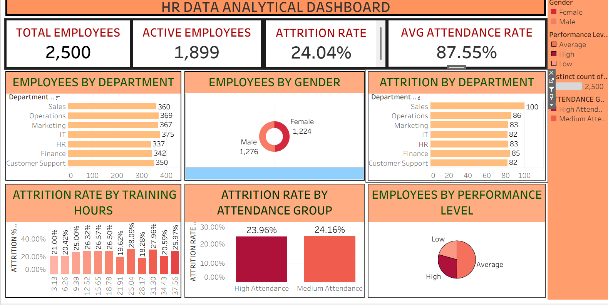

# HR Data Analysis Dashboard – Tableau

## Project Overview
This project focuses on analyzing employee data to identify workforce trends and patterns using Tableau. An interactive dashboard was developed to present important HR insights and support data-driven decision-making.

## Project Objectives
- Analyze employee demographics.
- Understand employee attendance patterns.
- Evaluate employee performance.
- Analyze employee attrition.
- Present HR insights through an interactive dashboard.

## Tools & Technologies
- Tableau
- Microsoft Excel

## Key Analysis
- Employee Demographics
- Gender Analysis
- Attendance Analysis
- Performance Analysis
- Attrition Analysis

## Dashboard Preview

## Project Files
- `HR_DATA_ANALYTICAL.twbx` – Tableau packaged workbook.
- `HR-DATA-ANALYSIS-DASHBOARD.png` – Dashboard screenshot.

## Conclusion
The dashboard provides an overview of employee demographics, attendance, performance, and attrition. It helps present workforce information in a clear and interactive way.
